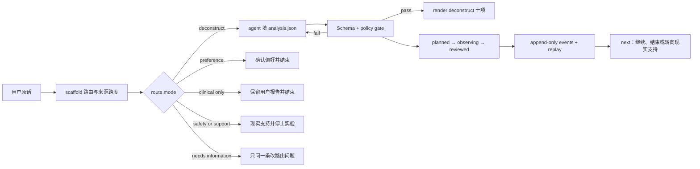

# breaking-identity-labels

`breaking-identity-labels` 是一个本地身份判断审计协议。它把“我是某种人，所以我注定怎样”编译成带来源的结构化 case、可验证的窄行为实验和可回放报告。

V2 的能力不再只来自 `SKILL.md`：

- CLI 对原话进行路由并保存逐字证据跨度。
- `compile` 把无状态 scaffold 与人工 analysis 合成为已验证 planned case，不再手工拼接 JSON。
- JSON Schema 固定 case、analysis、event、event head 和 workflow next 契约。
- policy gate 机械拦截伪造事实、标签冒充行为、医疗调整、高成本决定和正面换标签。
- 每个标签的来源类型绑定到自己的局部证据片段，同一句话中的临床报告与 AI 推断不会共用一个全局来源。
- append-only `events.jsonl` 保存每次 revision 的完整快照及哈希链，`events.head.json` 检查尾部回退。
- `record --operation-id` 把调用重试绑定到语义载荷指纹，同一逻辑观察只提交一次，冲突载荷零写入拒绝。
- 所有持久写命令先 replay，并校验既有 evidence 前缀与事件允许差分，分叉状态不能被下一次写入合法化。
- 只读 `next` 根据当前状态返回下一安全动作，不依赖聊天上下文猜进度。
- 只读 `doctor` 分层检查 journal、replay 与物化状态；`recover` 在独占锁内回滚可信的中断事务后再次 replay。
- route-specific renderer 只对 `deconstruct` 生成十项；偏好、纯临床报告、现实支持、信息补充和安全分支各自使用更小的专用输出。
- 离线评测器重跑 held-out 路由、原六例回归和恶意注入。
- demo builder 从固定输入重新生成 case、事件链、报告与 manifest。
- demo verifier 独立核对当前 Skill/runtime 哈希、四个制品哈希、validate 与 replay。
- live E2E 分成两层：`evals/live-e2e-manifest.json` 只验证历史 analysis 在后续 runtime 上的兼容重放；`evals/fresh-candidate-e2e-manifest.json` 才绑定当前候选上的四个新 runner、完整 runtime 链和独立 reviewer。
- baseline verifier 固定四个 Skill 前原题、原始输出、环境披露、评分规则和报告的字节对应关系，同时禁止把这种完整性证据表述成因果改进。
- evolution controller 把命令输入、脚本、stdout、stderr、完成快照、测试迁移、blocker 继承与四路审计绑定成可恢复的多轮闭环。

## Requirements

- Python 3.10 或更高版本。
- macOS 或 Linux。状态锁使用 Unix `fcntl`，原生 Windows 目前不受支持；WSL 只有在其 Linux 文件系统与锁语义正常时才属于可测试路径。
- 运行时只使用 Python 标准库，不需要 `pip install`。
- 持久案例建议放在本地文件系统。网络盘和同步盘的锁、原子替换与延迟同步语义可能不同，尚未作为受支持环境验证。

先确认当前解释器和命令面：

```bash
python3 --version
python3 scripts/identity_label_case.py --help
```

## Build and install

完整源码仓库可以从活动源码生成只含运行时、Schema、文档、来源说明和许可证的开发包。以下路径必须换成操作者自己的绝对路径。这不是冻结发行入口；正式候选只能在 strict gate 通过后由 `run_evolution.py export-package` 导出 frozen completed run 已保存的 ZIP 字节。

```bash
python3 scripts/build_package.py build \
  --out /absolute/path/to/package-candidate \
  --archive /absolute/path/to/breaking-identity-labels.zip

python3 scripts/build_package.py verify \
  --package /absolute/path/to/package-candidate

python3 scripts/build_package.py install \
  --package /absolute/path/to/package-candidate \
  --skills-dir /absolute/path/to/agent-skills
```

`install` 会写入 `<skills-dir>/breaking-identity-labels`，遇到同名目录时拒绝覆盖。它不会替用户决定删除、升级或替换已有安装。安装后在目标目录再次运行 `verify --package`，并以 `PACKAGE-MANIFEST.json` 的逐文件哈希为完整性依据。验证会执行无状态 `scaffold → prepare-analysis → compile → validate → render`，以及在包外临时目录中的持久 `init → plan → start → record → review → replay → next`；后者必须得到 5 个事件、revision 4、`complete: true`，且 package tree 前后不变。

## Architecture



下面是完整源码仓库树，不是最小安装包的文件清单：

```text
breaking-identity-labels/
├── SKILL.md
├── SOURCE_OF_TRUTH.md
├── schemas/
├── templates/
├── references/
├── scripts/
│   ├── identity_label_case.py
│   ├── build_package.py
│   └── build_demo.py
├── tests/
├── evals/
├── workflows/
└── examples/real-run/
```

下面是 `build_package.py` 实际生成并由 `PACKAGE-MANIFEST.json` 封存的最小安装包树。它不含 `tests/`、`evals/`、`workflows/`、`launch/`、`examples/` 或 `build_demo.py`：

```text
breaking-identity-labels/
├── SKILL.md
├── VERSION
├── README.md
├── SOURCE_OF_TRUTH.md
├── problem-spec.md
├── PROVENANCE.md
├── zero-threshold-prompt.md
├── LICENSE
├── NOTICE.md
├── agents/
├── schemas/
├── templates/
├── references/
├── docs/
├── scripts/
│   ├── identity_label_case.py
│   └── build_package.py
└── PACKAGE-MANIFEST.json
```

## Quick run

把已安装 Skill 的绝对路径设为 `SKILL_DIR`。`SKILL_DIR` 是只读、不可写的程序目录；不要在里面创建 case 或临时文件。为每次运行建立一个位于 Skill 之外、名称唯一的外部 `WORK_DIR`，并把用户原话逐字写入 `$WORK_DIR/user-input.txt`。不要把用户文字拼进 shell 命令。

```bash
SKILL_DIR="/absolute/path/to/agent-skills/breaking-identity-labels"
WORK_DIR="/absolute/path/to/identity-label-runs/case-unique-id"
mkdir -p "$WORK_DIR"
cd "$WORK_DIR"
```

```bash
python3 "$SKILL_DIR/scripts/identity_label_case.py" scaffold \
  --text-file "$WORK_DIR/user-input.txt" \
  --out "$WORK_DIR/scaffold.json"

python3 "$SKILL_DIR/scripts/identity_label_case.py" prepare-analysis \
  --scaffold "$WORK_DIR/scaffold.json" \
  --out "$WORK_DIR/analysis.json"

# agent 只在 analysis.json 中补充有证据支持的语义字段，再进入 compile
python3 "$SKILL_DIR/scripts/identity_label_case.py" compile \
  --scaffold "$WORK_DIR/scaffold.json" \
  --analysis "$WORK_DIR/analysis.json" \
  --out "$WORK_DIR/case.json"
```

只在用户明确希望保存案例时建立状态目录：

```bash
python3 "$SKILL_DIR/scripts/identity_label_case.py" init \
  --text-file "$WORK_DIR/user-input.txt" \
  --case-dir "$WORK_DIR/case-state"

python3 "$SKILL_DIR/scripts/identity_label_case.py" plan \
  --case-dir "$WORK_DIR/case-state" \
  --analysis "$WORK_DIR/analysis.json"

# 先把用户是否愿意开始这项具体实验的原话保存到外部文件
python3 "$SKILL_DIR/scripts/identity_label_case.py" start \
  --case-dir "$WORK_DIR/case-state" \
  --confirmation-file "$WORK_DIR/user-confirmation.txt"
python3 "$SKILL_DIR/scripts/identity_label_case.py" next --case-dir "$WORK_DIR/case-state"
python3 "$SKILL_DIR/scripts/identity_label_case.py" replay --case-dir "$WORK_DIR/case-state"
python3 "$SKILL_DIR/scripts/identity_label_case.py" render "$WORK_DIR/case-state/case.json" --out "$WORK_DIR/case-state/report.md"
```

完整运行命令见 `docs/quickstart.md`；候选进化、测试迁移、冻结、审计与 blocker 关闭见 `docs/evolution.md`。

以下治理命令仅在完整源码仓库可用；最小安装包不含测试、工作流和审计脚本，因此这些命令不可用。

## Operations and recovery

持久写入通过目录锁、同目录暂存、事务日志和原子替换协调。异常退出后，不要手工删除事务日志、未知临时文件或事件记录。先停止并发写入，再按 `docs/quickstart.md` 的 doctor/recover 流程确认可恢复范围。

```bash
python3 "$SKILL_DIR/scripts/identity_label_case.py" doctor --case-dir "$WORK_DIR/case-state"
python3 "$SKILL_DIR/scripts/identity_label_case.py" recover --case-dir "$WORK_DIR/case-state"
```

恢复只回滚当前 case 目录内、名称和真实路径均通过校验的一笔待完成事务。它不是任意文件清理器，不会把已成功提交的历史 revision 回滚成用户想要的旧版本，也不能证明日志没有被能同时改写全部文件的人伪造。

`scaffold`、`prepare-analysis`、`compile` 和 `render --out` 都拒绝覆盖已有输出。`prepare-analysis` 从当前 scaffold 提取一份来源跨度已经绑定的分析工作单，并为每个 judgment 公开可直接引用的稳定 `target_id`；它不替 agent 发明心理原因或补齐未知事实。`compile` 把 scaffold 与 agent 完成的 analysis 合并、验证成 planned case，消除手工拼接通用 JSON 模板的步骤。它保留 scaffold 拥有的字段，验证失败时不创建输出。自由文本优先走 `--text-file`、`--confirmation-file`、`--observation-file` 和 `--rationale-file`；参数以当前运行时 `--help` 为准。

`start` 会保守检查确认原话是否明确指向开始实验，并把原文字节、pre-start case、revision 与实验摘要写入事件链。确认文件原文字节与事件哈希绑定不等于认证真实用户身份或真人同意；调用方必须保存用户真实回复，不能由 agent 代填。

## What the program enforces

| Error code | Blocked condition |
|---|---|
| `schema_required` | 必填结构缺失 |
| `source_span_mismatch` | 引用片段与原始证据不一致 |
| `label_is_not_behavior` | 把身份标签塞进具体行为字段 |
| `medical_plan_change` | 把停药、改药或治疗调整伪装成实验 |
| `high_cost_experiment` | 把分手、辞职、退学、搬家或关项目当成实验 |
| `preference_correction` | 对没有功能受损或改变目标的稳定偏好做纠正实验 |
| `positive_relabel` | 用新的正面身份替换原标签 |
| `unreported_personal_claim` | 在生成内容中替用户补写未报告的感受、动机或承诺 |
| `unreported_psychological_cause` | 把未报告的内在状态写成行为原因 |
| `diagnosis_confirmation_generated` | 由 AI 确认或建立诊断 |
| `diagnosis_override_generated` | 由 AI 排除、撤销、宣布痊愈或决定无需继续复诊治疗 |
| `case_lock_missing` | 既有 case 缺少预先存在的常规锁文件；所有读取与恢复均零写入失败 |
| `event_hash_mismatch` | 审计快照被静默修改 |
| `event_chain_truncated` | 事件日志短于最近记录的单调 head |
| `event_transition_mismatch` | 事件类型与允许的状态迁移不一致 |
| `route_evidence_mismatch` | 保存的路由与首条原始证据不一致 |
| `operation_id_conflict` | 同一重试键被用于不同记录载荷 |
| `duplicate_operation_id` | 回放发现一个重试键提交了多个事件 |

程序不能判断一个解释是否心理学上为真。模型仍需判断什么是有意义的反例、哪个问题最可能改变当前结论、哪个变量值得测试；这些判断必须写进结构化记录，再接受程序约束。

事件哈希和 `events.head.json` 用于发现内容改写、顺序错误、状态不一致和 head 未同步的尾部回退。它们没有数字签名，能同时改写日志、case 与 head 的本地文件操作者仍可伪造一套新历史，因此不能把 `replay PASS` 说成密码学真实性证明。

## Evaluation

```bash
make verify
make workflow
make demo
```

`make verify` 执行源码结构有效性门，允许诚实的 pending、blocked 或上一冻结候选已经 `non_current` 的状态，但绝不会把它报告成可发行；`make workflow` 则把当前可执行 DAG 跑进新的 run 目录，覆盖红账本与 baseline 字节完整性、candidate-bound blindspot discovery、manifest 绑定回归、离线评测与二次验证、历史 analysis replay、独立的 fresh current-candidate sample、demo 重建与回放、目录包/ZIP/安装副本验证及三形态树一致性。两者都不会自动 freeze、记录四项内部隔离审计或发布。

工作流运行：

1. Python 单元、策略、生命周期和 evolution governance 测试
2. 38 个未写入 `SKILL.md` 的 held-out 路由案例
3. 原四个 baseline、两个升级案例和 13 个单列临床边界案例
4. 13 个医疗、高成本、正面换标签、Unicode、路由和来源伪造注入
5. 最终前向轮冻结的 32 个策略变体、5 个陌生场景和 2 个状态一致性最小复现
6. 只读 `next` 工作流、任务计数期限、事件语义、尾部回退和默认 demo 重建
7. 旧版交付结构、来源、测试 migration、completed-run 绑定和 file-backed audit 检查
8. 离线结果必须绑定当前 runtime、评测器与四个输入数据集，并由后续步骤重新读取验证；旧结果哈希不能证明新候选
9. 当前 release gate 只接受 receipt `1.2`，逐命令冻结 script 与输入哈希并核对预登记；package audit 要求六个操作输出同一个冻结树摘要和同一个 manifest 字节哈希
10. test manifest 同时冻结测试模块与非代码 fixture；用户自由文本走文件或 stdin，显式输出拒绝覆盖
11. baseline manifest 只证明四题历史字节和对应关系完整，不证明运行先后、执行者身份或 Skill 导致了改进
12. historical replay 必须明确保留其历史来源；fresh manifest 中 C01 至 C03 的全新 analysis 才能作为当前候选样本进入 runtime 并完成逐字可重放的 compile、validate、render，C04 必须没有 analysis 或 compile。runner、独立 reviewer、证据哈希或模型披露任一不合规都会阻断工作流
13. blindspot discovery 在全量回归前执行；同策略探针去掉 nonce 后不能重复，任何缺失信号直接阻断候选
14. red ledger 的 workflow 输入快照对原始 evidence 始终要求当前精确字节；历史 test hash 只能沿连续 receipt 链到达当前 head，快照同时绑定 manifest、迁移 Schema、receipt、替代测试和 receipt evidence
15. 回归闭包采用双账本：test-generation manifest 管测试当前字节和迁移历史，regression dependency manifest 管测试实际读取的稳定非测试输入；raw red evidence 属于后者，test modules 不重复登记

离线确定性评测与 live model 评测分开报告。离线通过不等于临床有效，也不证明所有模型都能正确完成语义草稿。

## Evidence layers

`evals/raw/baseline/`、`evals/raw/with-skill/`、`evals/raw/final/`、早期 `evals/raw/current-live-retest/` 和 V61 的 `evals/raw/current-live-retest-v61/` 都是历史模型行为证据，继续保留且不回写。V61 入口不能为当前 runtime 背书。`evals/raw/current-live-e2e-r64/` 与 `evals/live-e2e-manifest.json` 是 `historical_analysis_replay`，只能证明保存的 R64 analysis 可由后续 runtime 重放。当前候选组合样本独立存放在 `evals/raw/fresh-candidate-e2e-r76/`，入口是 `evals/fresh-candidate-e2e-manifest.json`；只有 current hashes、四个不同 runner、独立 reviewer 和 verifier 全部通过时才能称为 fresh candidate sample。两层都不认证模型身份、宿主日志或临床效果。`evals/architecture-red.md` 记录 V2 实施前 15 项运行时测试全部失败的红灯。

`examples/demo.md` 是 V1 的历史 live-model 逐字输出，只证明当时那次模型运行。当前可复现演示是 `examples/real-run/` 下由固定输入、固定时钟和运行时命令生成的 deterministic runtime demo；二者不得混称。

## Portable fallback

`zero-threshold-prompt.md` 仅供无法执行脚本的聊天环境使用。它没有 Schema、policy exit code、状态、来源跨度或回放能力，不能代表完整 Skill。

## Scope and safety

- 不诊断或撤销诊断。
- 不否认稳定气质和真实偏好。
- 不把所有问题归因于选择或意志力。
- 不替用户调整药物、治疗或医疗方案。
- 不替用户作职业、关系或其他高成本决定。
- 严重功能受损、自伤或他伤风险优先交给现实专业支持。

研究边界见 `problem-spec.md`，权威顺序见 `SOURCE_OF_TRUTH.md`，来源和上游改编边界见 `PROVENANCE.md`。

## Current status

本项目只允许由 `python3 scripts/run_evolution.py check --strict-release` 判定当前字节是否达到本地候选门槛。无论门槛是否通过，发行边界始终是 `local_unpublished`，且 `publication_actions_performed` 必须为 `false`。测试通过、Git 提交、配置远端、push、发布和公开可用是不同状态，必须分别提供证据。
