# Evolution workflow and blocker loop

以下治理命令仅在完整源码仓库可用；最小安装包不含测试、工作流和审计脚本，因此这些命令不可用。已安装运行时的日常使用请遵循 `docs/quickstart.md` 的只读 `SKILL_DIR` 与外部唯一 `WORK_DIR` 契约。

This document describes the full-source development controller. It is not required for ordinary case-time use and it never commits, pushes, publishes or opens the repository.

## Why this is a loop

The controller does not treat “tests passed once” as completion. Every candidate is bound to the exact workflow, tests, runtime, schemas, demo, package and governance scripts that produced it.

```mermaid
flowchart LR
    A["Immutable red evidence"] --> B["Implement narrow mechanism"]
    B --> V["Baseline and red-ledger verification"]
    V --> X["Candidate-bound blindspot discovery"]
    X --> C["Registered full regression"]
    C --> D["Bound offline eval"]
    D --> E["Fresh deterministic demo"]
    E --> L["Historical analysis replay"]
    L --> N["Fresh current-candidate composition"]
    N --> P["Package byte equivalence"]
    P --> F["Completed run snapshot"]
    F --> G["Freeze exact candidate"]
    G --> H["Four file-backed audits"]
    H -->|"zero blockers"| I["local_unpublished candidate"]
    H -->|"blocker"| J["hash-bound next iteration"]
    J --> A
```



There is no fixed iteration limit. A failed or blocked run remains evidence; it is not rewritten as passing.

## Current executable workflow

`workflows/v78-final-release.json` is the current command DAG. It performs:

1. verification of an immutable historical red command receipt;
2. verification of the append-only red ledger, including continuous receipt-backed historical test migrations while raw evidence bytes remain exact;
3. verification of the frozen pre-Skill baseline bytes, prompt correspondence, rubric and report, without a causal-improvement claim;
4. audit-harness self-check;
5. candidate-bound blindspot generation before the closed-world regression, with within-strategy probe diversity and fail-on-blindspot behavior;
6. every manifest-registered unittest after verifying the complete non-code test-fixture inventory;
7. offline evaluation bound to the runtime, evaluator and four datasets;
8. run-local deterministic demo build and separate verification;
9. R64 historical analysis replay through the current runtime;
10. a separate fresh current-candidate four-case agent/runtime composition sample and independent review;
11. directory and zip package build;
12. directory, zip and temporary-install verification, including stateless and persistent lifecycle smoke, payload-tree equality, manifest-byte equality and package-tree immutability.

`workflows/v2-evolution.yaml` is a human-readable design map. `workflows/v15-evolution.json` is obsolete red-stage evidence; v51 and v65 are historical predecessors; v68 is retained as a compatibility predecessor for the R73 contract. None can prove the current candidate is complete.

## Create, inspect and resume a run

Use a new run directory and identifiers. Existing runs and receipts refuse overwrite.

```bash
python3 scripts/run_evolution.py run \
  --workflow workflows/v78-final-release.json \
  --run-dir evals/runs/<run-id> \
  --run-id <run-id> \
  --candidate-id <candidate-id>

python3 scripts/run_evolution.py status \
  --run-dir evals/runs/<run-id>

python3 scripts/run_evolution.py resume \
  --run-dir evals/runs/<run-id>
```

An external workflow node, when present in another workflow, pauses with `awaiting_external_action`. It can advance only with a Schema-valid receipt whose evidence files already exist and match their hashes:

```bash
python3 scripts/run_evolution.py complete-external \
  --run-dir evals/runs/<run-id> \
  --step-id <step-id> \
  --receipt <receipt.json>
```

The current final workflow has no external node; all of its build steps are executable and shell-free.

## Test generation and migration

After adding a new `tests/test_vN_*.py` file, and only after its content is stable, register it:

```bash
python3 scripts/run_evolution.py sync-tests
```

`sync-tests` adds new files and generation rules. It refuses to bless changed hashes for already registered tests. A legitimate correction to an existing test requires a prewritten migration receipt and the migration command:

```bash
python3 scripts/run_evolution.py migrate-test \
  --receipt evals/test-migrations/<migration>.json
```

Migration validation checks the from/to chain, reason, evidence files, replacement test semantics and historical hashes. The red ledger may accept an old test hash only when that same-path chain is continuous to the current bytes and every receipt remains hash-valid and semantically consistent. Raw red evidence never receives this historical-hash exception. The evolution controller applies the same rule while building a command input snapshot: it records current test bytes plus the manifest, migration Schema, receipts, replacement tests and receipt evidence instead of comparing a historical test hash directly with the current file. Deleting a test or leaving a receipt orphaned invalidates the gate.

## Freeze one completed run

Freeze only after the run reports `status: complete`. The completed run directory is mandatory:

```bash
python3 scripts/run_evolution.py freeze \
  --candidate-id <candidate-id> \
  --workflow workflows/v78-final-release.json \
  --completed-run-dir evals/runs/<run-id>
```

Freeze verifies the run-state hash, event head and count, receipt tree, workflow hash, candidate ID and completed seven-part artifact snapshot. It preserves every unresolved blocker already remembered by release state even when no new blocker argument is supplied. Any candidate byte change after freeze invalidates previous audit results.

## Four internal isolated audit receipt `1.2` records

The full-source audit harness has four preregistered suites:

- `independent_attribution_audit`
- `independent_clinical_safety_audit`
- `independent_state_integrity_audit`
- `release_package_audit`

The three `independent_*` names are legacy protocol IDs retained for receipt compatibility. These suites execute in the same repository under the same local authority. They are not third-party audits, and actor authentication is not established.

First verify the harness inventory:

```bash
python3 scripts/run_release_audits.py self-check
```

Then generate and record each receipt. The harness refuses to overwrite an existing evidence directory or receipt.

```bash
python3 scripts/run_release_audits.py run \
  --state evals/release-gate.json \
  --run-dir evals/runs/<run-id> \
  --audit-id <audit-id> \
  --receipt-id <unique-receipt-id>

python3 scripts/run_evolution.py record-audit \
  --receipt evals/receipts/<unique-receipt-id>.json
```

A current receipt stores preregistration, environment, exact argv arrays, each script hash, a sorted pre-execution input snapshot, exit codes, stdout, stderr, raw findings and blockers. Version `1.2` copies the exact completed-run binding from the frozen state. The controller opens the hashed preregistration and requires its audit ID, candidate, completed-run hash, command argv and input-file declarations to match the receipt. The package suite installs the ZIP, verifies the installed copy and requires build, directory verify, archive verify, install, installed verify and equivalence outputs to match the frozen package-tree hash and one manifest byte hash. A passing receipt with a failed command, changed input, mismatched preregistration, different candidate or replayed completed run is rejected. Versions `1.1` and `1.0` are explicit legacy fixture formats and cannot satisfy the current release gate or close a current inherited blocker.

## Blocker inheritance and evidence-bound closure

Freeze may add a blocker as `ID:severity:evidence-path`, but omission may never clear a remembered blocker. An open blocker is hashed into release state, rejects a new root run and is automatically carried to a successor. Freeze and audit take the release-state and run locks in one fixed order so concurrent compliant processes cannot silently lose an update.

```bash
python3 scripts/run_evolution.py next-iteration \
  --previous-run-dir evals/runs/<previous-run> \
  --run-dir evals/runs/<next-run> \
  --run-id <next-run> \
  --candidate-id <next-candidate> \
  --carry-over-blocker ID:P1:evals/raw/<evidence>.md
```

Closing a blocker is not a status edit. The resolution receipt must bind the original blocker, source predecessor, a completed repaired run, separate implementation and regression evidence, and a passed completed-run-bound audit finding whose verification step matches a real successful command receipt from that repaired run.

```bash
python3 scripts/run_evolution.py next-iteration \
  --previous-run-dir evals/runs/<blocked-run> \
  --run-dir evals/runs/<next-run> \
  --run-id <next-run> \
  --candidate-id <next-candidate> \
  --resolve-blocker evals/blocker-resolutions/<receipt>.json
```

The controller continuously re-hashes resolution evidence. Deleting or changing it invalidates both the successor lineage and any release projection.

## Export the frozen package

After strict release succeeds, export only the authenticated ZIP already stored inside that frozen completed run:

```bash
python3 scripts/run_evolution.py export-package \
  --state evals/release-gate.json \
  --out-dir dist/breaking-identity-labels-<version> \
  --out-archive dist/breaking-identity-labels-<version>.zip
```

The exported directory is extracted from those same ZIP bytes. The command validates the frozen ZIP manifest and payload tree, refuses to overwrite either target and never rebuilds from the active source tree. `--verify-only` checks an existing export against the frozen bytes without recreating it.

## Gate commands and terminal meaning

```bash
python3 scripts/run_evolution.py check --allow-blocked
python3 scripts/run_evolution.py check --strict-release
```

`--allow-blocked` returns success only when the recorded state is structurally valid, even if it honestly reports `blocked`. `--strict-release` succeeds only when the exact frozen candidate has zero blockers and all four current audits pass.

Even strict success means only:

```text
distribution_status = local_unpublished
publication_actions_performed = false
```

It does not mean committed, pushed, published, public, clinically validated or cryptographically authenticated.

## Execution and durability limits

- Run locks are non-blocking cooperative `fcntl` locks. They do not stop non-cooperating processes and are not validated on network or synchronised filesystems.
- Command children receive only the explicit controlled environment and the executed script is hash-bound. They still run with the current OS user’s filesystem and network permissions; this is not a sandbox.
- The controller uses local consistency checks and atomic single-file replacement where implemented, but does not promise crash-atomic commit across every event, receipt and state file.
- A local actor who can rewrite all related files can create a different self-consistent history. Hashes and manifests are not signatures.
- External side effects of a command are not automatically rolled back.
