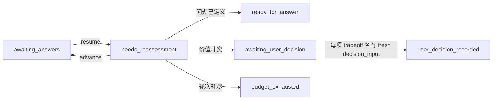

# 提问前定义问题

版本：`0.3.0-rc.4`  
状态：本地发行候选，未 commit、未 push、未发布，fresh host gate 待完成。

核心命题：**AI 让答案越来越便宜，但它没有让“什么才算答对”变便宜。**

## 它解决什么

“我该不该辞职”“怎么用 AI 提高效率”“帮我做一个能赚钱的 AI App”都能被模型回答得很完整，但用户常常还没有定义现实结果、决定性事实、成功证据和不可接受代价。此时答案越漂亮，越可能把代理问题伪装成正解。

这个 Skill 先判断：

1. 任务是否已经定义充分，可以直接执行。
2. 当前提问是否只是工具、方案或情绪上的代理问题。
3. 哪些缺失信息会改变路线、风险或成功判断。
4. 哪些价值冲突只能由用户本人决定。

它不是 prompt 润色器，不输出万能提问公式，也不替用户拍板辞职、分手、医疗、法律或投资。定义充分的翻译、转换、计算与执行任务直接放行。

## 为什么它已经不是“用户提示词”

| 层 | 可执行能力 | 约束对象 |
|---|---|---|
| 路由层 | `gate` + [`runtime/routes.json`](runtime/routes.json) | `execute / define / defer_to_user` 优先级和渐进资源加载 |
| 数据层 | 三份 JSON Schema | 请求信封、Problem Spec、证据循环状态 |
| 验证层 | `validate` | gate receipt 重算、请求绑定、来源跨度、类别覆盖、最多三问、停止边界 |
| 交付层 | `render` | 确定性十二节输出，不能手写标题绕过 validator |
| 会话层 | `start / resume / advance / amend / status / decide` | 回答变证据、CAS、幂等、修订历史、轮次预算、用户决策事件 |
| 演化层 | `dpbp-evolve` | RED→GREEN→复现声明→审查→晋级提案、哈希链、holdout、预算与饱和停止 |
| 安装层 | allowlist packager + `agents/openai.yaml` | 可复现 lean bundle、正负触发边界、开发资产隔离 |

[`SKILL.md`](SKILL.md) 现在只是短 dispatcher。详细字段语义、领域边界和状态契约按需从 `references/` 加载，不再把整套方法压成一段让模型“自觉遵守”的长提示词。

## 最短运行路径

在本目录执行，JSON 从 stdin 读取：

```bash
scripts/dpbp gate --offline < request-envelope.json
scripts/dpbp init < request-envelope.json > problem-spec.draft.json
scripts/dpbp validate < problem-spec.json
scripts/dpbp render < problem-spec.json
scripts/dpbp doctor
```

真正需要多轮时才启动证据循环：

```bash
scripts/dpbp start --state /explicit/state.json --max-rounds 3 < problem-spec.json
scripts/dpbp resume --state /explicit/state.json < answer.json
scripts/dpbp status --state /explicit/state.json
scripts/dpbp advance --state /explicit/state.json < advance.json
scripts/dpbp amend --state /explicit/state.json < amendment.json
scripts/dpbp decide --state /explicit/state.json < user-decision.json
```



回答会形成 `answer:<id>` 证据源。`amend` 只会 supersede 旧证据，不会删除历史。零问题的未收敛 spec 进入 `needs_reassessment`，`status` 只报告当下真实可执行的动作。`confirmed` 的现实结果和每项成功标准都必须绑定后续 active answer 或 amendment；模型新提的验收标准只能先留在 provisional，用户明确确认后才能收敛。“记录是否变得更好”这类元包装仍不算可判定证据。高风险流进入 `awaiting_user_decision` 后，每一项 `tradeoff_id` 都要有独立的 fresh 决定，未覆盖完就继续等待；精确 selected span 本身必须形成正向承诺。“我决定不了”、疑问、背景事实、重复决定同一取舍和问题定义阶段的旧答案都不能冒充完整终态。完整协议见 [`references/runtime-loop.md`](references/runtime-loop.md)。

状态运行时使用 POSIX `fcntl`，当前支持 macOS 与 Linux，不承诺原生 Windows。不要在没有真实续接需要和用户授权时持久化敏感回答。

## 失败驱动的自进化 workflow

[`scripts/dpbp-evolve`](scripts/dpbp-evolve) 是源码仓库内的 maintainer 工具，不进入 lean 安装包，也不会自动改 Skill：

1. 从唯一的 [`evals/suite-manifest.json`](evals/suite-manifest.json) 读取 hash-bound suite。
2. 记录 `failure_observed` 与 base RED receipt。
3. 候选实现必须得到 GREEN receipt 和 reproducer 的同结果 receipt；三份 receipt 的输入哈希都必须绑定同一个 manifest case，cycle 的 base receipt 还必须逐字段等同于 `failure_observed` 当时保存的原始 RED receipt。
4. author、reproducer、reviewer 必须声明三个不同 actor ID。
5. reviewer 才能 `promote`。已有 regression case 被标记 promoted；新 failure 只生成 hash-bound `manifest_proposal`，必须由 maintainer 显式写入 manifest 并重新跑全套测试。
6. sealed holdout 只消费一次；迭代预算耗尽或连续无增益会强制停止。

账本逐行保存 `sequence / previous_hash / payload_digest / state_sha256 / event_hash`；每次读取都会核对当前派生 state 与最后一个 checkpoint，重复 `init` 也不能绕过校验。同一个 cycle ID 只有完全相同的 payload 才能幂等重放。运行时还拒绝 state/ledger 路径别名、非有限数、事件命名空间碰撞、矛盾 receipt，以及 stop 后的新 mutation；已落账的完全相同 replay 仍幂等返回。它能发现只改 state、不改 ledger 的篡改，但无密钥哈希不能阻止同时重写两者。Actor identity 目前是 `self_attested`，run artifact 是 `hash_declared`；本地工具不能认证真人身份，也不能证明这些哈希一定来自受信 runner。对外声称独立复现前仍需认证身份和可复核工件。流程说明见 [`evals/evolution/README.md`](evals/evolution/README.md)。四个原始用例已经被多轮开发反复使用，因此现在明确属于公开 regression，不再冒充未见 holdout。

每一轮 preserved failure、RED、边界改动、GREEN 和剩余未知都记录在 [`evals/evolution/development-rounds.md`](evals/evolution/development-rounds.md)。这份账本把“自我进化”限定为可回滚的测试驱动变更，不把不断增加规则等同于进步。

## 测试与证据

| 阶段 | 结果 | 准确含义 |
|---|---:|---|
| Prompt-only 架构 RED | 0/12 | `0.1` 没有 CLI、Schema、状态或自动验证 |
| 无 Skill baseline | 1/4 | 三道模糊题直接回答错题，清楚翻译题通过 |
| RC.1、RC.2、RC.3 host | 每轮 1/4 | 每轮真实失败都进入下一轮 regression |
| 历史 `0.2.0-rc.4` host behavior | 4/4 | 四个新鲜会话通过语义审计，但 code audit 阻断发行 |
| 历史 `0.2.0-rc.6` 自动测试 | 67/67 | 旧的一次性 runtime、架构、state 与 runner 回归通过 |
| 当前 `0.3.0-rc.4` 自动测试 | 134/134 | 证据循环、逐项价值决定、用户确认验收、全字段高风险边界、演化终态、路径与事件完整性、红队防绕过和包装契约全部通过 |
| 独立 agent-context 尾验 | targeted 51/51；full 134/134 | 复放 B1-B11、多 tradeoff 与 symlink；不是认证外部实验室或 host 行为认证 |
| 当前离线 regression | 4/4，gate 每题 100 次 | 路由字节级稳定，三份 spec fixture 可验证和渲染 |
| 当前 agent-context shadow | 4/4 | 两个隔离无历史代理上下文覆盖四题；不是目标宿主 discovery 或官方 host score |
| 历史 `0.2.0-rc.6` fresh host | 4 次尝试，0 次完成 | 模型回答前被账户 usage limit 阻断，没有分数 |
| 当前 fresh host | 未完成 | 不把历史 `0.2.0-rc.4` 或 `0.2.0-rc.6` 结果改名成当前版本证据 |

Baseline failure：辞职题替用户决定并发明标准；AI 提效题列十项工具并编造百分比；AI App 题发明用户、付费意愿、价格和技术栈；翻译题正确直接执行。原始输入输出见 [`evals/baseline-report.md`](evals/baseline-report.md)。

当前同题离线复测：DPBP-001 路由到 `defer_to_user`；DPBP-002、003 路由到对应 `define` playbook；DPBP-004 返回 `execute` 和空资源。两个隔离 agent-context shadow run 的四题行为也为 4/4，原始输入输出与严格降级说明见 [`evals/retest/runtime-v0.3-rc4-shadow/results.md`](evals/retest/runtime-v0.3-rc4-shadow/results.md)。这两层都不等于目标宿主会发现 Skill，offline fixture 也不等于 host 模型会稳定生成正确语义。

冻结 B1-B11、多 tradeoff 与 symlink 攻击集的独立 agent-context targeted replay 为 51/51，完整套件为 134/134。范围、最终 bundle hash、隐私边界和剩余发行门见 [`evals/rc4-final-audit.md`](evals/rc4-final-audit.md)。

运行：

```bash
PYTHONDONTWRITEBYTECODE=1 python3 -m unittest discover -s tests -v
PYTHONDONTWRITEBYTECODE=1 python3 evals/runtime/run_runtime_evals.py --output evals/runtime/results.json
```

## 已测试环境

- 日期：2026-08-06
- 主机：macOS 26.5.2，build 25F84，arm64
- Python：CPython 3.14.4
- 历史 host runner：OpenAI Codex CLI 0.132.0，请求模型 `gpt-5.5`
- 当前自动测试：离线、本地文件系统、无模型 API、无网络
- 当前平台边界：macOS/Linux POSIX state lock

证据只覆盖四个中文 regression case 和当前本机，不证明跨模型、跨语言、原生 Windows、长期现实效果或生产稳定性。

## Lean bundle

```bash
python3 scripts/package_skill.py --target-root /explicit/empty-directory
```

Packager 只复制 [`install-manifest.json`](install-manifest.json) 的显式 allowlist，逐级拒绝叶文件或任一父目录的符号链接、解析后路径逃逸、缺失文件和已有目标，并比较 source/staged/target tree hash。测试、历史 eval、demo、视频 brief 和 maintainer evolution runtime 不进入安装包。

两次独立 staging 构建得到相同 allowlist tree hash，bundle 内 official quick validator 与 `doctor` 均通过；这仍不是宿主发现或真实安装证据。命令与边界见 [`evals/install-bundle-verification-rc4.md`](evals/install-bundle-verification-rc4.md)。唯一通过隐私扫描的是该 Skill 的显式 allowlist bundle。完整 Skill 源码树的历史 host 环境记录仍含四个 Codex session ID，候选仓库整仓还包含其他组件和私有工作流路径；两者都不是当前可发行物，若未来分发完整源码必须先单独审查或脱敏。

## 真实 demo 与视频骨架

- [`examples/demo.md`](examples/demo.md)：分开 baseline host、历史 `0.2.0-rc.4` host、当前 offline runtime 与真实多轮 state demo。
- [`launch/video-brief.md`](launch/video-brief.md)：只含观点地图、逻辑骨架、演示、反例、Solution、钩子和标题方向，不含逐字稿，不创建 VP、HL、TP。

## 权利结论

本项目明确借鉴并改写 dontbesilent dbskill 固定提交 `8282f010964601070334dd7350973386abff6d2b` 的 Question / Problem 区分、语义做工、问题消解和现实反馈机制。允许非商业分享和改编的依据是上游 [CC BY-NC 4.0](https://creativecommons.org/licenses/by-nc/4.0/)，不是用户的非商业承诺本身。

对外分享须署名 dontbesilent、链接许可、标记修改、不暗示背书并遵守 NonCommercial。更准确的标签是“非商业源码开放候选”或 source-available，不是 OSI open source。当前整包暂用 CC BY-NC 4.0；Creative Commons 不建议把 CC 许可证用于软件，因此公开发行前仍须拆分代码与内容许可，或明确记录兼容性、source/object code 与专利边界。完整来源见 [`PROVENANCE.md`](PROVENANCE.md)。

## 当前发行状态

本地 `0.3.0-rc.4` 候选。尚未 commit、未配置 remote、未 push、未发布，也不宣称已经开源。公开发行门仍包括：fresh host discovery 与同题输出、跨模型/多 trial、目标宿主真实安装验证、整仓隐私边界复核和软件许可拆分。
