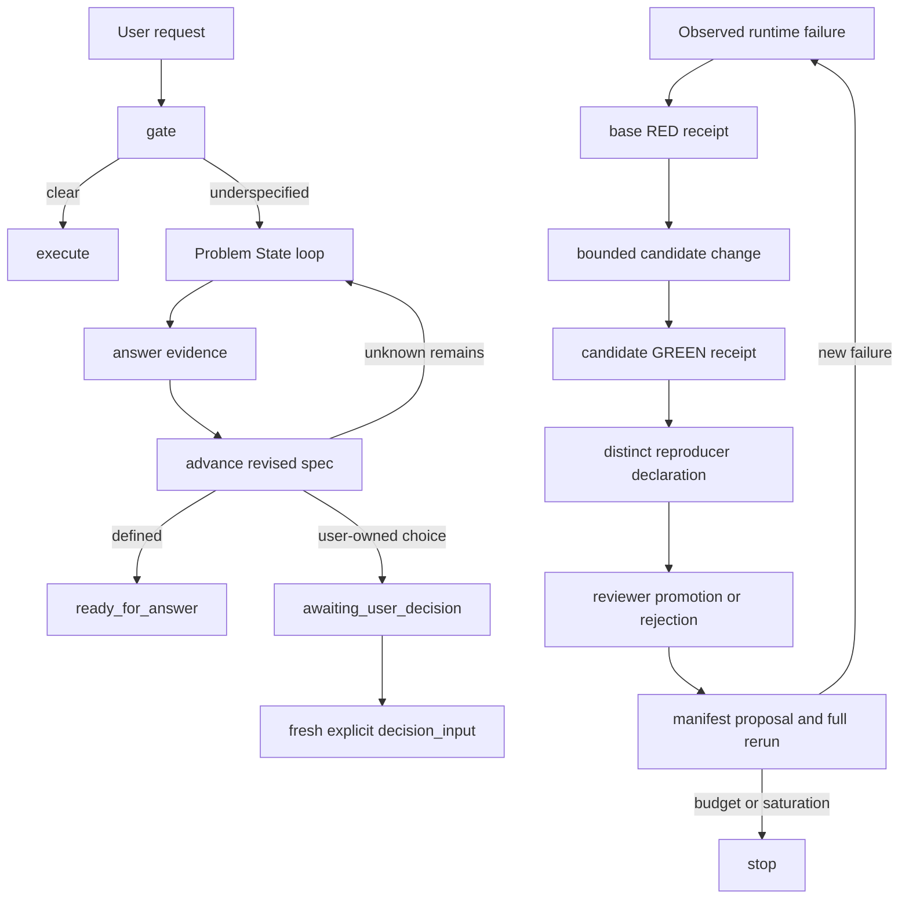

# Multi-round development ledger

Version under review: `0.3.0-rc.4`  
Date: 2026-08-06  
Status: local evidence record, not an external certification.

This ledger records how observed failures changed the executable contract. It is not a narrative that every newer version is automatically better. A round counts only when it has a preserved failure, a bounded change and a rerun against the relevant regression set.

## Two different loops

The first loop improves one user's problem definition without deciding their values. The second controls changes to the Skill. `dpbp-evolve` records and rejects evidence states; it deliberately does not edit runtime code or the suite manifest.

## Recorded rounds

| Round | Preserved failure | Contract change | Rerun result | What it still did not prove |
|---|---|---|---|---|
| R0 prompt-only | Architecture checks found no CLI, Schema, validator, state or install contract | Rejected the long-instruction prototype as the product architecture | Architecture baseline `0/12` | No behavioral improvement yet |
| R1 executable gate | Baseline answered three underspecified questions and only passed translation | Added `gate`, request envelope, Problem Spec Schema, validator, renderer and direct-task pass-through | Offline four-case routing became reproducible | Model could still hide advice inside valid fields |
| R2 semantic bypasses | Host runs inserted delay advice, tool menus, invented thresholds and product forms | Added receipt binding, typed unknown coverage, source spans, domain playbooks and structured next-test stop boundaries | Historical `0.2.0-rc.4` host behavior reached `4/4` | Code audit still found state and provenance defects |
| R3 state integrity | Receipt/state could be recomposed, pending questions forged and concurrent resume conflicted | Added recomputation, stable unknown IDs, question coverage, revision CAS, file lock, atomic replace and idempotent replay | Historical `0.2.0-rc.5`/`0.2.0-rc.6` contract suite `67/67` | Fresh host retest was blocked before model output |
| R4 user evidence loop | One-shot output could not ingest answers, retain corrections or stop boundedly | Added `start/resume/advance/amend/status/decide`, active evidence sources, superseded history, terminal phases and round budget | First seven black-box loop tests went RED then GREEN | Final user choice still reused diagnostic input |
| R5 maintainer evolution loop | Iteration history had no promotion gate, role separation, holdout lifecycle or stop rule | Added hash-chain ledger, base/candidate/reproduction receipts, distinct declared roles, proposal-only promotion, budget and saturation stop | First six evolution tests went RED then GREEN | Receipts were not bound to the manifest input; state could drift from ledger |
| R6 adversarial state closure | Fresh value decisions had no input channel; zero-question specs deadlocked; “好” could fake convergence | Required post-terminal `decision_input`, added `needs_reassessment`, dynamic allowed actions, low-information rejection and non-circular success evidence | Evidence-loop suite `14/14` | Host identity remains unauthenticated; natural-language checks remain incomplete |
| R7 ledger and package closure | Different inputs could populate one cycle; derived state could be edited; symlinked parent escaped the allowlist root | Bound all receipts to one manifest input, checkpointed post-event state and checked every packaging path ancestor | Evolution `11/11`; packaging `8/8`; full suite `109/109` | Unkeyed hashes cannot resist coordinated state plus ledger rewriting; no trusted external runner |
| R8 tail-audit closure | A decision marker outside the selected span legitimized a background fact; close-cycle could replace the observed RED receipt; repeated init bypassed checkpoint; cycle replay hid replacement evidence | Checked the exact selected span, checkpointed and required the original RED receipt, validated repeated init, and made cycle replay payload-exact | Problem loop `15/15`; evolution `14/14`; full suite `113/113` | Text rules do not prove complete semantic relevance; external identity and runner trust remain unresolved |
| R9 convergence evidence closure | “I want to become better” plus a model-invented “record whether” criterion reached confirmed; “I cannot decide” became terminal; verdicts hid in unscanned fields | Required active user-sourced structured criteria, added acceptance-core determinacy, positive commitment and recursive model-semantic high-risk scanning | Problem loop `19/19` | Language checks still cannot prove entailment or authenticate the speaker |
| R10 evolution fail-closed closure | Path aliases overwrote files; NaN bypassed saturation; event collisions corrupted ledgers; stop states mutated; contradictory RED receipts became dead failures | Added alias/finite/namespace/receipt gates, global event uniqueness, terminal immutability, exact committed replay and persisted-phase responses | Evolution `29/29`; full suite `132/132` | No cross-file transaction, keyed integrity, authenticated actors or trusted run artifacts |
| R11 multi-tradeoff terminal closure | Deciding only `t1` ended a two-tradeoff loop; a forged terminal could contain two unique events that both targeted `t1` | Derived expected tradeoff IDs from the spec, enforced unique decision/tradeoff coverage, kept partial states waiting and rejected duplicate coverage before writing | Problem loop `21/21`; full suite `134/134` | Text provenance still does not authenticate the person or prove that a choice semantically resolves its named tradeoff |

## Current loop gate

A future change is not promoted merely because its output looks better. The maintainer workflow requires:

1. One named failure and a base receipt whose input hash matches the suite manifest.
2. A bounded candidate change rather than an unrestricted rewrite.
3. The cycle reuses the exact observed RED receipt, then adds candidate and reproduction receipts over the same input.
4. Three distinct declared actor IDs for author, reproducer and reviewer.
5. Reviewer approval plus a manifest proposal for any new case.
6. A full suite rerun after the manifest is deliberately updated.
7. Stop when the iteration budget is exhausted or the configured improvement window is saturated.

These are local integrity gates, not proof of organizational independence. Actor IDs are self-attested, artifacts are hash-declared, and the current four cases are public regressions whose holdout value has been spent.

## Next legitimate rounds

The next useful loop is evidence acquisition rather than more rule accumulation:

- Run fresh host discovery and the frozen four inputs on the current bundle.
- Add new sealed cases that target paraphrased low-information answers, multilingual routing, crash recovery and high-risk decision provenance.
- Retain runner outputs so a reviewer can verify bytes, not only supplied hashes.
- Separate software and content licensing before any public distribution decision.

Until those gates are completed, `0.3.0-rc.4` remains a local candidate.
